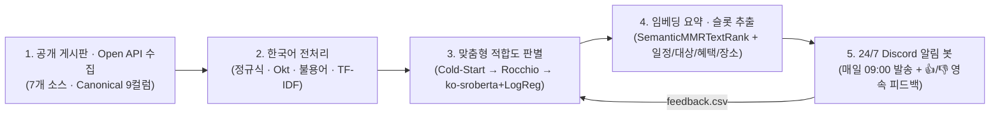
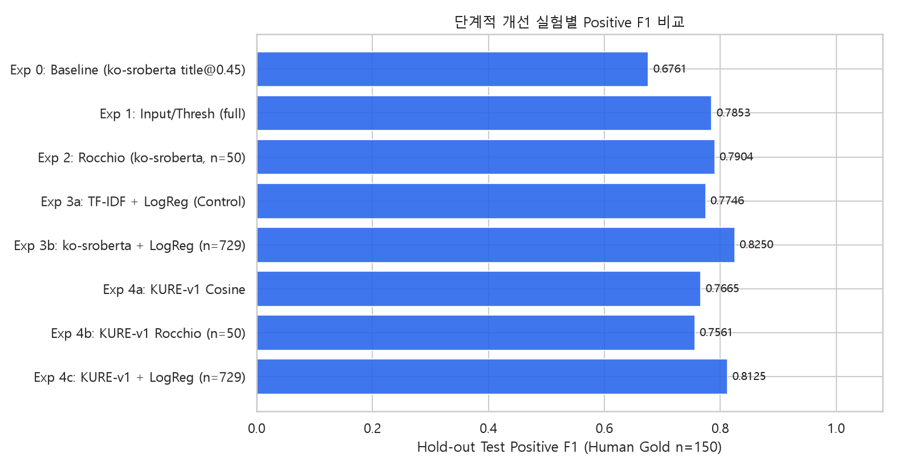
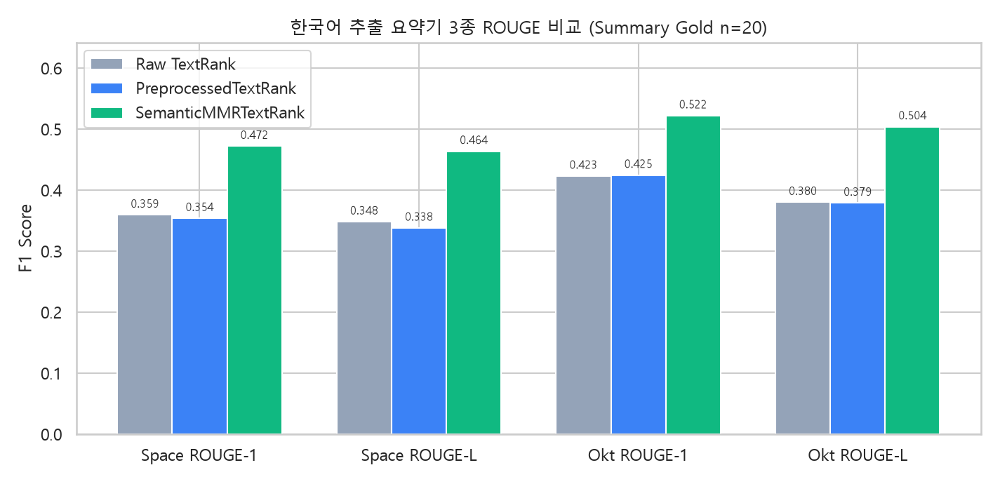

# notice-filter-nlp

> **문장 임베딩과 사용자 피드백 기반 맞춤형 공지·채용·청년 복지 선별 알림 시스템**  
> 여러 공개 게시판과 오픈 API에 흩어진 공지 중 관심사와 무관한 노이즈를 걸러내고, 핵심 3줄 요약 및 구조화된 핵심 정보 슬롯을 매일 지정 시각 Discord로 전달하며, 버튼 클릭 피드백을 다음 주기 모델에 자동 반영합니다.

---

## 1. 전체 동작 흐름



### 왜 단순 LLM 전수 호출 대신 경량 NLP 파이프라인을 쓰나요?
- **비용·속도·독립성**: 오프라인 학습 데이터 초기 라벨링(Silver) 단계에서만 LLM Judge(`claude-haiku-4-5-20251001`)를 활용하고, 매일 돌아가는 추론·요약·재학습 서버는 오픈소스 경량 임베딩(`ko-sroberta-multitask`)과 `LogisticRegression`·`TextRank`로 API 비용 없이 자체 운영합니다.
- **환각(Hallucination) 없는 요약**: 생성형 요약 대신 임베딩 기반 추출 요약 + 규칙 기반 슬롯 추출을 결합해 마감일·지원금액·장소 숫자 왜곡을 방지하고, 추론 직후 모델을 메모리에서 해제(`unload()`)합니다.

---

## 2. 주요 기능

1. **다중 소스 수집 및 계약 기반 정규화 ([src/collectors/](src/collectors/), [src/schema.py](src/schema.py))**
   - 학과 공지(`swcon`), 취업·비교과 공개 목록(`goodjob`), 지자체 청년 포털(`성남청년다해`), 정부 오픈 API(`온통청년`) 7개 소스를 `robots.txt` 준수 및 9컬럼 표준 스키마(`NoticeRecord`)로 통합합니다.
2. **단계적 개인화 선별 모델 ([src/models/scorer.py](src/models/scorer.py))**
   - **Cold-Start (`Exp 0`~`1`)**: 사용자 프로필 관심/제외 쿼리 임베딩 코사인 유사도 + 부정 감점
   - **소량 피드백 (`Exp 2`)**: 피드백 벡터 기반 `Rocchio` 프로필 보정
   - **누적 피드백 (`Exp 3b`)**: `ko-sroberta-multitask` + `LogisticRegression` (대조군 `TF-IDF` 및 1024d 최신 모델 `KURE-v1`과 1:1 비교 검증)
3. **임베딩 기반 추출 요약 + 핵심 슬롯 ([src/models/summarizer.py](src/models/summarizer.py))**
   - **`SemanticMMRTextRankSummarizer`**: 분류에 적재된 `ko-sroberta` 임베딩을 재사용(추가 모델·RAM 0 증가)해 문장 의미 그래프 PageRank + 공지 제목 유사도 + MMR 중복 제어를 적용합니다.
   - **`extract_notice_slots()`**: 본문에서 `일정/기한 · 대상 · 지원/혜택 · 장소`를 자동 추출해 Discord 카드의 `📋 핵심 정보` 필드로 표시합니다.
4. **Core ↔ Adapter 분리 & 24/7 상시 데몬 ([src/adapters/discord/](src/adapters/discord/), [scripts/run_alert_pipeline.py](scripts/run_alert_pipeline.py))**
   - NLP 코어는 외부 I/O와 완전히 분리되어 오프라인 단위 테스트(53건)와 CPU 노트북 단독 재현을 보장하며, 실운영 데몬은 `관심 👍 / 제외 👎` 버튼 클릭을 `data/feedback.csv`에 즉시 기록해 다음 주기에 가중치(`3x`) 재학습합니다.

### Discord 알림 카드 예시
```text
🏛️ 성남청년다해 · 청년정책
2026 청년의 시간 참가팀 모집
• 「청년의 시간(청년 참여형 정책 포럼)」 참가팀을 모집합니다.
• 모집대상 : 성남시 거주·재직·재학·활동 청년(19~39세) 3~6명으로 구성된 팀
• ② 참가 신청서 및 사업(프로그램) 제안서 작성
🏷️ `성남시` `청년정책`

📌 출처: 🏛️ 성남청년다해   |   🎯 적합도: 🟢 89% (높음)   |   ⏰ 마감일: 2026-11-22 (D-5)
📋 핵심 정보
📅 일정/기한: 10.30 ~ 11.22
👥 대상: 성남시 거주·재직·재학·활동 청년(19~39세) 3~6명
💰 지원/혜택: 총 시상금 400만 원
📍 장소: 판교유스센터

[ 관심 👍 ]   [ 제외 👎 ]   [ 🔗 원문 보기 ]
```

---

## 3. 정량 검증 결과 (`Hold-out Human Gold`)

Validation Set(`val.csv`, `n=100`) 단독 튜닝 후 잠금 설정(`results/val_tuned_config.json`)을 **사람이 직접 채점한 Hold-out Test (`n=150`)** 및 **요약 참조 정답 (`n=20`)**에 1회 평가한 결과입니다.  
*(참고: LLM Judge vs Human Gold 일치율 `n=150`: Accuracy `0.8400` / Cohen's Kappa `0.6785`)*

| 태스크 | 모델 / 실험 단계 | 핵심 지표 | 비고 |
|---|---|---:|---|
| 공지 선별 (`n=150`) | `Exp 0` Baseline (`ko-sroberta title@0.45`) | F1 `0.6761` / Acc `0.6933` | Cold-Start 기준선 (`P=0.6857, R=0.6667`) |
| 공지 선별 (`n=150`) | `Exp 1` (`full` + 부정 감점 + `thr=0.37`) | F1 `0.7853` / Acc `0.7667` | Baseline 대비 `+0.1092 F1` |
| 공지 선별 (`n=150`) | `Exp 2` (`Rocchio n=50`, `thr=0.51`) | F1 `0.7904` / Acc `0.7667` | 소량 피드백 보정 (`R=0.9167`) |
| 공지 선별 (`n=150`) | `Exp 3a` (`TF-IDF + LogReg`, 대조군) | F1 `0.7746` / Acc `0.7867` | 어휘 기반 선형 분류기 (`P=0.7857`) |
| 공지 선별 (`n=150`) | **`Exp 3b` (`ko-sroberta + LogReg`)** | **F1 `0.8250` / Acc `0.8133`** | **최종 채택 (`P=0.7500, R=0.9167`, `+0.1489 F1`)** |
| 공지 선별 (`n=150`) | `Exp 4c` (`KURE-v1 + LogReg`) | F1 `0.8125` / Acc `0.8000` | 1024d 최신 임베딩 통제 비교군 (`McNemar p=0.7266`) |
| 추출 요약 (`n=20`) | `TextRank` (Raw Baseline) | Okt R1 `0.4232` / RL `0.3802` | 공백 ROUGE-L `0.3482` |
| 추출 요약 (`n=20`) | `PreprocessedTextRank` | Okt R1 `0.4246` / RL `0.3789` | 세분화 분절 시 TF-IDF 희소화 확인 |
| 추출 요약 (`n=20`) | **`SemanticMMRTextRankSummarizer`** | **Okt R1 `0.5221` / RL `0.5040`** | **공백 ROUGE-L `0.4638` (`+0.1238` Okt), 슬롯 `20/20`** |

> 본 데이터셋은 공개 목록 특성상 **72.7%가 본문 없는 짧은 제목 위주(`n=729`)**이므로, 단일 `seed=42` 통제 비교에서 768d `ko-sroberta + LogReg`(`0.8250`)가 1024d `KURE-v1 + LogReg`(`0.8125`)를 소폭 상회해 실운영 기본 모델로 채택했습니다.

<p align="center">
  
  
</p>

상세 학습 곡선, 소스별 오류 분석 및 제3자 코드 감사 결함 수정 내역은 [실험 및 오류 분석 리포트](docs/04_Experiment_and_Error_Report.md)에서 확인할 수 있습니다.

---

## 4. 저장소 구조

```text
notice-filter-nlp/
├── config/
│   └── profile.yaml              # 예시 사용자 프로필·관심/제외 쿼리·Judge Rubric (커스터마이징 가능)
├── data/
│   ├── sample_notices.csv        # 9컬럼 Canonical Schema 샘플 20건 (계약 테스트·오프라인 시연용)
│   ├── raw_notices.csv           # 수집·정규화 통합 공지 979건
│   ├── silver_labels.csv         # LLM Judge Silver 라벨 979건
│   └── splits/                   # 누수 방지 3-way 분할 (train / val / test_gold / summary_eval_gold)
├── deploy/                       # 클라우드 24/7 상시 데몬 가이드·경량 의존성·systemd 유닛
├── docs/                         # SRS/RTM, 아키텍처 계약, ADR-01~07, 실험·오류분석·감사 리포트
├── notebooks/                    # CPU 전용 Restart & Run All 검증 완료 파이프라인 노트북
├── results/                      # Val/Test 정량 결과 JSON, 오류/요약 비교 CSV, 시각화 PNG
├── scripts/                      # 수집, 분할, 라벨링, 임베딩 캐시, 실험, 24/7 알림 데몬 CLI
├── src/
│   ├── config.py                 # .env 탐색, profile 로더, CUDA/CPU 자동 분기
│   ├── schema.py                 # 9컬럼 NoticeRecord & 5컬럼 FeedbackRecord 계약
│   ├── collectors/               # 공개 게시판/API 수집 어댑터 (swcon, goodjob, seongnam, youth_api)
│   ├── preprocess/               # 한국어 정제, Okt 토크나이저, 불용어, TF-IDF, WordCloud
│   ├── models/                   # SentenceEmbedder(+unload), Scorer 계층, SemanticMMR TextRank & Slots
│   ├── eval/                     # 분류 지표(F1), 한국어 ROUGE, Kappa, 층화 분할
│   └── adapters/discord/         # Discord Embed(핵심 정보 슬롯) 및 영속 버튼 피드백 어댑터
├── tests/                        # 오프라인 계약 및 단위 테스트 (53 tests)
├── .env.example                  # 필수/선택 환경변수 템플릿
├── pyproject.toml
└── requirements.txt
```

---

## 5. 빠른 시작 (Quick Start)

### ① 전체 실험·노트북·형태소 분석 환경 (Python 3.11 + JDK 17)
```powershell
python -m venv .venv
.\.venv\Scripts\Activate.ps1
pip install -r requirements.txt
# (선택) 로컬 CUDA GPU 가속 시:
# pip install torch --index-url https://download.pytorch.org/whl/cu124
```
- `KoNLPy Okt` 형태소 분석·ROUGE 평가를 위해 JDK 17(Temurin 등)이 필요합니다.
- 오프라인 단위 테스트 실행 (53건):
```powershell
.\.venv\Scripts\python.exe -m pytest -v
```

### ② 경량 24/7 Discord 서빙 환경 (Java/KoNLPy 불필요)
실운영 서버나 봇만 구동할 때는 순수 Python 경량 패키지만 설치하면 됩니다.
```bash
pip install -r deploy/requirements-serve.txt
cp .env.example .env
# .env에 DISCORD_BOT_TOKEN, DISCORD_CHANNEL_ID, (선택) YOUTH_POLICY_API_KEY / YOUTH_CONTENT_API_KEY 입력
```

### ③ 프로필 커스터마이징 및 실행
1. [config/profile.yaml](config/profile.yaml)의 `user`, `interests.positive_queries`, `negative_queries`를 본인 전공·관심 직무·거주 지역에 맞게 수정합니다. (현재 저장소에는 **소프트웨어 전공 대학생 · 성남시 청년 정책** 기준 예시 프로필이 포함되어 있습니다.)
2. 오프라인 샘플 드라이런 → 실수집 시딩 → 24/7 데몬 실행:
```powershell
# (A) 외부 크롤링·Discord 토큰 없이 즉시 오프라인 드라이런 확인
.\.venv\Scripts\python.exe scripts\run_alert_pipeline.py --once --input-csv data/sample_notices.csv --max-alerts-per-run 3

# (B) 기존 수집 공지(979건) 중복 발송 방지 시딩 후 실수집 드라이런
.\.venv\Scripts\python.exe scripts\run_alert_pipeline.py --seed-seen-from data/raw_notices.csv
.\.venv\Scripts\python.exe scripts\run_alert_pipeline.py --once

# (C) 24/7 상시 봇 데몬 (매일 09:00 KST 자동 수집·알림 + 상시 👍/👎 버튼 피드백 저장)
.\.venv\Scripts\python.exe scripts\run_alert_pipeline.py --daemon --daily-at 09:00 --timezone Asia/Seoul
```
Linux 서버(`systemd --user`) 상시 배포 절차는 [deploy/ORACLE_DEPLOY.md](deploy/ORACLE_DEPLOY.md)를 참고하세요.

### ④ EDA · 정량 실험 · 노트북 재현
```powershell
# Train Pool 전용 EDA 및 WordCloud 차트 재생성
.\.venv\Scripts\python.exe scripts\run_eda.py

# Validation 단독 튜닝 및 Hold-out Human Gold 1회 평가
.\.venv\Scripts\python.exe scripts\run_experiments.py --mode val-only
.\.venv\Scripts\python.exe scripts\run_experiments.py --mode final-eval
```
전체 파이프라인은 CPU 전용 환경(`CUDA_VISIBLE_DEVICES="-1"`)에서 `Restart & Run All` 검증을 완료한 [notebooks/notice_filter_pipeline.ipynb](notebooks/notice_filter_pipeline.ipynb)로도 그대로 재현할 수 있습니다.

---

## 6. 설계 문서 · 보안 원칙 · 한계 및 향후 과제

- **설계 및 검증 문서**:
  - [01. 요구사항 명세서 및 추적 매트릭스 (SRS/RTM)](docs/01_SRS_and_RTM.md)
  - [02. 시스템 아키텍처 및 인터페이스 계약](docs/02_Architecture_and_Contract.md)
  - [03. 아키텍처 의사결정 기록 (ADR-01~07)](docs/03_ADR.md)
  - [04. 실험 결과 · 심층 오류 분석 · 코드 감사 리포트](docs/04_Experiment_and_Error_Report.md)
  - [파이프라인 재현 노트북](notebooks/notice_filter_pipeline.ipynb) (`CUDA_VISIBLE_DEVICES="-1"` CPU 검증 완료)
- **보안 및 크롤링 윤리 (ADR-02)**:
  - 각 사이트 `robots.txt`를 점검하고, **로그인이 필요한 교내 인트라넷 크롤링 및 개인 계정(`.env`) 자동 로그인은 일절 수행하지 않습니다.**
  - 모든 API 키·봇 토큰·런타임 피드백(`feedback.csv`)·발송 상태(`sent_notices.json`)는 `.gitignore`로 Git 추적에서 제외됩니다.
- **알려진 한계 및 향후 고도화 (Backlog)**:
  - **제목 절단·본문 부재 병목 (`NTF-23`)**: `goodjob` 공개 목록의 제목 말줄임(`…`, Test 18.0%) 및 본문 미수집(ADR-02) 구간은 `🔗 원문 보기` 버튼으로 보완 중이며, 향후 OCR/VLM 포스터 파싱 확장이 가능합니다.
  - **표면 키워드 잔여 오탐지 (`NTF-21`)**: `일반대학원`·비IT 대기업 공고 등 경계 FP 억제를 위해 1차 **규칙 기반 Hard Filter** + 2차 **임베딩 Soft Filter** 하이브리드 구조로 확장 예정입니다.
  - **교차 재게시 그룹 분할**: 원 게시판 재게시로 `full` 입력이 일치하는 `6/150건(4.0%)`에 대해 향후 텍스트 해시 기반 그룹 분할을 적용할 예정입니다.
