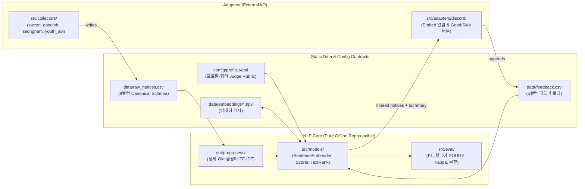
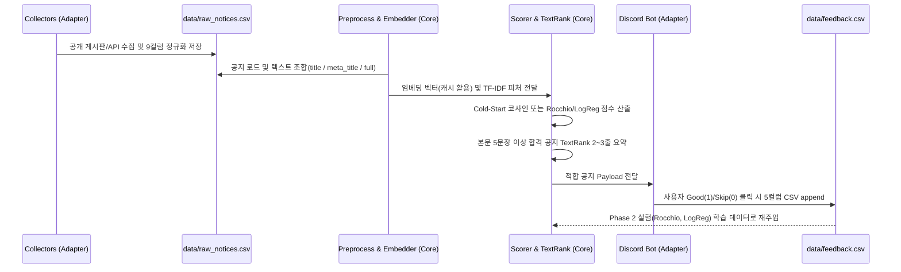

# 02. 시스템 아키텍처 및 인터페이스 계약

## 1. 컴포넌트 아키텍처 (Core ↔ Adapter 분리)

---

## 2. 실행 시퀀스 (수집 → 선별/요약 → 피드백 → Phase 2 개선 루프)

---

## 3. 데이터 계약 (Schemas)

### 3-1. Canonical Notice Schema (9컬럼 — `src/schema.py::NoticeRecord`)

| 컬럼명 | 타입 | 필수 여부 | 설명 |
|---|---|---|---|
| `id` | `str` | 필수(Unique) | `<source>_<원본ID>` 형태의 고유 식별자 |
| `source` | `str` | 필수 | `swcon_academic`, `swcon_career`, `goodjob_extracurricular`, `goodjob_general`, `goodjob_recommend`, `seongnam_youth`, `youth_api` |
| `category` | `str` | 필수(공백 허용) | 원 게시판 카테고리(예: `학사/졸업`, `일반채용`, `청년복지`) |
| `title` | `str` | 필수 | 공지 또는 채용 공고 제목 |
| `meta_tags` | `str` | 필수(공백 허용) | 파이프(`|`)로 구분된 메타 정보(캠퍼스·직무·지역 등) |
| `content` | `str` | 선택(`""`) | 본문 텍스트(`goodjob` 목록 전용 소스는 빈 문자열 허용) |
| `posted_at` | `str` | 필수(공백 허용) | 게시일 (`YYYY-MM-DD`) |
| `deadline` | `str` | 선택(`""`) | 마감일 (`YYYY-MM-DD` 또는 빈 문자열) |
| `url` | `str` | 필수 | 원문 공지 URL |

### 3-2. Feedback Log Schema (5컬럼 — `src/schema.py::FeedbackRecord`)

| 컬럼명 | 타입 | 제약 | 설명 |
|---|---|---|---|
| `notice_id` | `str` | 필수 | `NoticeRecord.id` 외래키 |
| `label` | `int` | `0` 또는 `1` | `1`: 관심(Good), `0`: 제외(Skip) |
| `source` | `str` | 필수 | 피드백 출처 (`discord`, `cli_gold`, `llm_silver` 등) |
| `timestamp` | `str` | 필수 | ISO-8601 타임스탬프 |
| `comment` | `str` | 선택(`""`) | 선택 사유 메모 |

---

## 4. Git Worktree 병렬 개발 및 파일 소유권 (File Ownership)

충돌을 방지하기 위해 각 Worktree는 지정된 디렉터리와 테스트 파일만 수정합니다.

### Phase 1: 기능 구현 병렬 Worktree (4개)

| Worktree 경로 (`../notice-filter-nlp-wt/`) | 브랜치 & Jira | 소유 경로 (수정 허용) | 금지 경로 |
|---|---|---|---|
| `wt-collector` | `feat/NTF-12-collector` (`NTF-12`) | `src/collectors/`, `tests/test_collectors.py` | `src/models/`, `src/preprocess/`, `src/adapters/` |
| `wt-preprocess` | `feat/NTF-13-preprocess` (`NTF-13`) | `src/preprocess/`, `tests/test_preprocess.py` | `src/collectors/`, `src/models/`, `src/adapters/` |
| `wt-nlp-core` | `feat/NTF-14-nlp-core` (`NTF-14`) | `src/models/`, `src/eval/`, `tests/test_models.py`, `tests/test_eval.py` | `src/collectors/`, `src/adapters/` |
| `wt-discord` | `feat/NTF-15-discord` (`NTF-15`) | `src/adapters/discord/`, `tests/test_discord.py` | `src/models/`, `src/preprocess/`, `src/collectors/` |

### Phase 2: 실험 루프 병렬 Worktree (Baseline 평가 & `NTF` Bug 발행 후 분기)

| Worktree 이름 | 실험 목적 | 주요 비교 대상 |
|---|---|---|
| `wt-exp-input` | 입력 텍스트 조합 & 임계값 튜닝 | `title` 단독 vs `meta_title` vs 임계값 스윕 |
| `wt-exp-rocchio` | 소량 피드백 반영 | Rocchio $\alpha, \beta$ 보정 vs Cold-Start Baseline |
| `wt-exp-logreg` | 누적 피드백 지도학습 | `ko-sroberta + LogReg` vs `TF-IDF + LogReg` |
| `wt-exp-modern` | 최신 한국어 임베딩 접목 비교 | `nlpai-lab/KURE-v1` (또는 `BAAI/bge-m3`) vs `ko-sroberta-multitask` |
