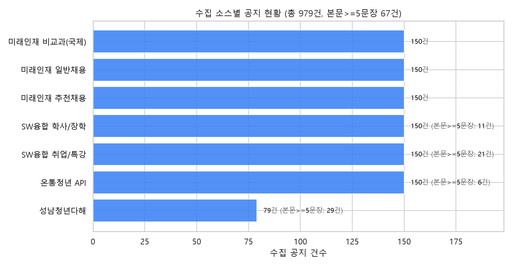
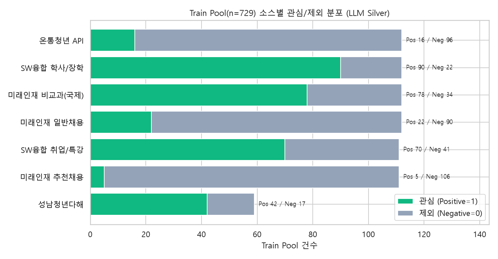
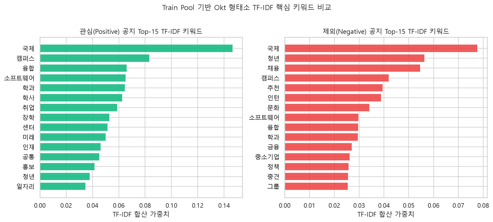
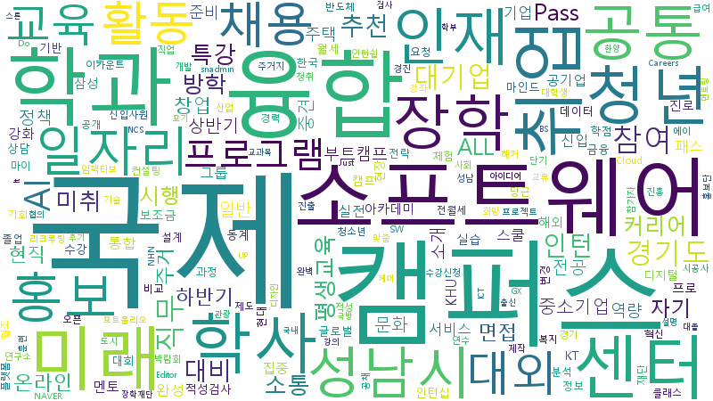
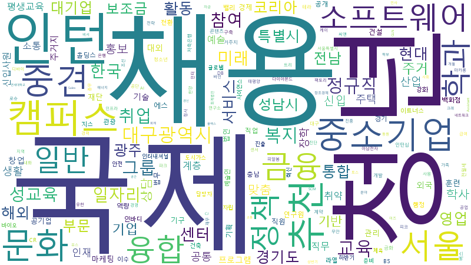
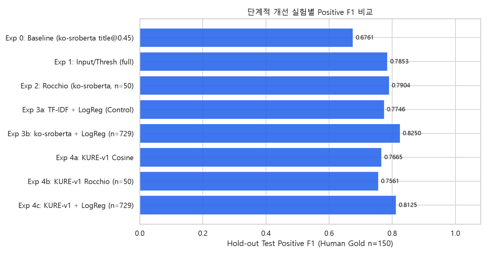
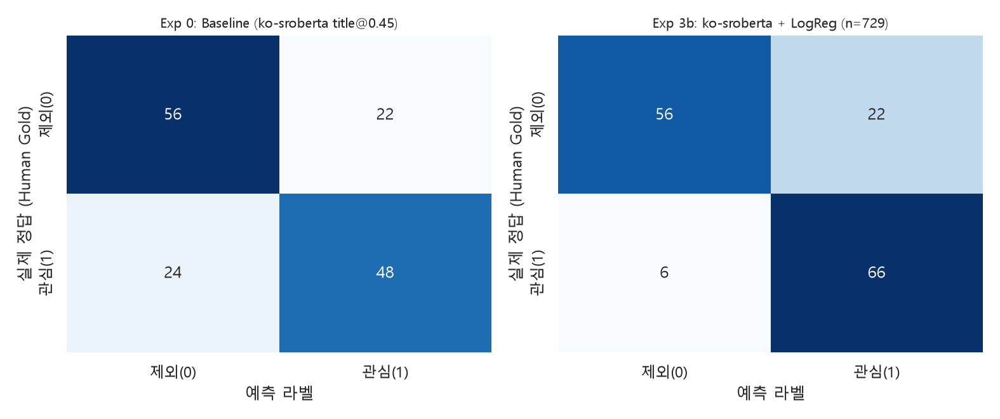
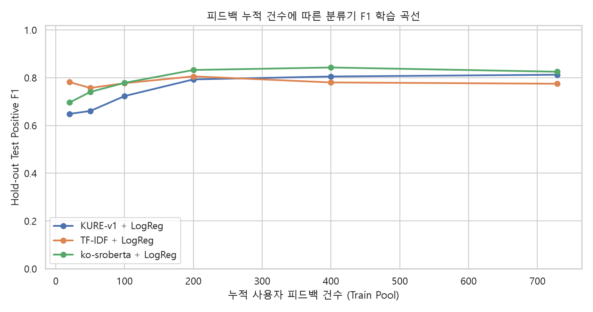

# 04. 실험 결과 · 심층 오류 분석 · 코드 감사 리포트

> 본 문서는 Validation Set(`val.csv`, `n=100`) 단독 튜닝 후 잠금(lock)된 설정(`results/val_tuned_config.json`)을 동일한 Hold-out Test Set(`test_gold.csv`, `n=150` Human Gold)에 1회 평가한 정량 지표, 심층 오류 분석(Jira `버그` 연동), 한국어 요약 ROUGE 비교 및 제3자 코드 감사 결함 수정 이력을 기록한 종합 기술 리포트입니다.
>
> **실험 원칙**: 데이터 누수(Leakage) 방지를 위해 Hold-out Test Set에 대한 재튜닝을 금지하며, `Exp 0`~`Exp 4c`는 각 모델 구성별 Validation 최적화 결과를 동일 Test Set에서 비교합니다. *(참고: ID 기준 중복은 `0건`이나, 원 게시판 재게시 등으로 `full` 입력이 일치하는 교차 공지 `6/150건(4.0%)`이 존재해 향후 그룹 분할로 고도화할 예정입니다.)*

---

## 1. 데이터셋 구성, EDA 및 라벨 신뢰도 검증

### 1-1. 수집 및 3-way 층화 분할 현황

- **수집 총량**: **`979 건`** (고유 정규화 공지, 5문장 이상 다문장 공지 `TextRank` 분리 기준 **`67 건`**)

| 수집 소스 (`source`) | 전체 수집 | `Train` (`n=729`, LLM Silver) | `Val` (`n=100`, LLM Silver) | `Hold-out Test` (`n=150`, Human Gold) | 본문 제공 여부 |
|---|---:|---:|---:|---:|---|
| `swcon_academic` | 150 | 112 | 15 | 23 | 제목 + 본문 |
| `swcon_career` | 150 | 112 | 15 | 23 | 제목 + 본문 |
| `goodjob_extracurricular` | 150 | 112 | 15 | 23 | 공개 목록 전용 (`content=""`, ADR-02) |
| `goodjob_general` | 150 | 112 | 15 | 23 | 공개 목록 전용 (`content=""`, ADR-02) |
| `goodjob_recommend` | 150 | 112 | 15 | 23 | 공개 목록 전용 (`content=""`, ADR-02) |
| `youth_api` | 150 | 111 | 16 | 23 | 제목 + 정책 본문/메타 |
| `seongnam_youth` | 79 | 58 | 9 | 12 | 제목 + 사업/공지 본문 |
| **합계** | **979** | **729** (`Pos 323 / Neg 406`) | **100** (`Pos 45 / Neg 55`) | **150** (`Pos 72 / Neg 78`) | Test 내 `content=""` 비율 `72.7%` |

- **Summary Eval Set (`summary_eval_20.csv`)**: `20 건` (5문장 이상 장문 공지 소스별 균등 추출, **Human Gold 참조 요약 20건 완료**)

### 1-2. EDA 시각화 (`data/raw_notices.csv` & `data/splits/train.csv`)

| Positive 공지 WordCloud | Negative 공지 WordCloud |
| :---: | :---: |
|  |  |

### 1-3. LLM-as-a-Judge vs Human Gold 신뢰도 분석 (`n=150`)

- **LLM Judge**: `claude-haiku-4-5-20251001` (`config/profile.yaml`의 `judge_rubric` 기준 오프라인 라벨링)
- **일치율 (`n=150`)**: **Accuracy `0.8400` (`84.0%`, 126/150 일치)** / **Cohen's Kappa `0.6785`** (*Substantial Agreement*)
- **불일치 `24건(16.0%)` 상세 분석 (`Judge=1 / Human=0`: 9건, `Judge=0 / Human=1`: 15건)**:

| 불일치 유형 | 실제 사례 (`id` / 제목) | LLM 판단 (`judge_reason`) vs Human 판단 | 시사점 |
|---|---|---|---|
| `Judge=1 / Human=0` | `swcon_career_552170`: `KHU Careers Editor 2.0 22기 참여자 모집` | LLM은 교내 취업 홍보단 활동을 긍정(1) 판정했으나, 사용자는 개발 직무 무관 홍보단으로 제외(0) | 교내 비교과·홍보단의 개인 선호는 프로필 텍스트만으로 완전 규정 불가 |
| `Judge=1 / Human=0` | `goodjob_general_52429`: `[앰코테크놀로지코리아] 2027년 상반기 공채 (인천/전남광주)` | LLM은 대졸 신입 공채를 긍정(1) 판정했으나, 사용자는 타지역·비IT 반도체 제조로 제외(0) | 본문 부재 시 기업명·근무지 선호 차이가 개입 |
| `Judge=0 / Human=1` | `goodjob_recommend_2102`: `[F&F] 채용연계형 인턴 추천채용` | LLM은 패션 기업으로 제외(0)했으나, 사용자는 추천채용 인턴에 관심(1) 표시 | 대기업·추천채용에서 IT 직무 포함 가능성을 사용자가 넓게 열어둠 |
| `Judge=0 / Human=1` | `seongnam_youth_biz_251`: `청춘남녀 만남행사 「SOLO MON의 선택」` | LLM은 IT/지원금 무관으로 제외(0)했으나, 사용자는 거주지(성남시) 청년 행사에 관심(1) 표시 | **Silver 풀은 유용한 초기 학습 자산이나, 실사용 Discord 버튼 피드백(`feedback.csv`)으로 개인 취향을 최종 보정해야 함을 시사** |

---

## 2. Validation 튜닝 및 Hold-out Test 단계적 비교 실험

### 2-1. Validation Set (`val.csv`, `n=100`) 하이퍼파라미터 잠금 결과

`test_gold.csv` 누수를 막기 위해 **오직 `train.csv`와 `val.csv`만 사용해** 입력 모드(`meta_title` vs `full`), 부정 감점 여부, `Rocchio` $(\alpha, \beta)$, `LogReg` $C$, 분류 임계값을 선택·잠금했습니다(`results/val_results.json` → `results/val_tuned_config.json`).

| 실험 단계 (Val `n=100`) | 탐색 및 잠금 설정 | Val Positive F1 | Val Precision | Val Recall | Val Accuracy |
|---|---|---:|---:|---:|---:|
| `Exp 0` (Baseline 고정) | `title`, `thr=0.45`, 부정 감점 없음 | `0.7200` | `0.6545` | `0.8000` | `0.7200` |
| `Exp 1` (`ko-sroberta` 입력/임계값) | **`text_mode="full"`**, **`use_neg=True`**, **`thr=0.37`** | `0.7636` | `0.6462` | `0.9333` | `0.7400` |
| `Exp 2` (`ko-sroberta` Rocchio n=50) | `alpha=0.25`, `beta=0.1`, `thr=0.51` | `0.7748` | `0.6515` | `0.9556` | `0.7500` |
| `Exp 3a` (`TF-IDF + LogReg`, 대조군) | `C=5.0`, `thr=0.50` | `0.8041` | **`0.7500`** | `0.8667` | `0.8100` |
| **`Exp 3b` (`ko-sroberta + LogReg`)** | **`C=2.0`**, **`thr=0.35`** (**Val 1위 선택**) | **`0.8269`** | `0.7288` | `0.9556` | **`0.8200`** |
| `Exp 4a` (`KURE-v1` Cosine) | `use_neg=False`, `thr=0.51` | `0.7395` | `0.5946` | **`0.9778`** | `0.6900` |
| `Exp 4b` (`KURE-v1` Rocchio n=50) | `alpha=1.0`, `beta=0.5`, `thr=0.53` | `0.7706` | `0.6563` | `0.9333` | `0.7500` |
| `Exp 4c` (`KURE-v1 + LogReg`) | `C=0.5`, `thr=0.40` | `0.8200` | `0.7455` | `0.9111` | **`0.8200`** |

### 2-2. Hold-out Test Set (`test_gold.csv`, `n=150` Human Gold) 최종 성능 비교

| 실험 단계 | Jira 티켓 | 모델 구성 및 Val 잠금 설정 | Positive F1 | Precision | Recall | Accuracy | 혼동행렬 `[TN, FP; FN, TP]` | 비고 |
|---|---|---|---:|---:|---:|---:|---|---|
| **Exp 0 (Baseline)** | `NTF-14` | `ko-sroberta` 코사인 유사도 (`title`, `thr=0.45`, 피드백 0건) | `0.6761` | `0.6857` | `0.6667` | `0.6933` | `[56, 22; 24, 48]` | Cold Start 기준선 (오분류 46건) |
| **Exp 1 (Input/Thresh)** | `NTF-17` | `ko-sroberta` `full` + 부정 프로필 감점(`0.25`) + `thr=0.37` | `0.7853` | `0.7033` | `0.8889` | `0.7667` | `[51, 27; 8, 64]` | Baseline 대비 **+0.1092 F1** (FN `24 -> 8`) |
| **Exp 2 (Rocchio)** | `NTF-18` | `ko-sroberta` 소량 피드백 `n=50` Rocchio ($\alpha=0.25, \beta=0.1, \text{thr}=0.51$) | `0.7904` | `0.6947` | `0.9167` | `0.7667` | `[49, 29; 6, 66]` | 소량 피드백만으로 F1 추가 상승 (`+0.0051`) |
| **Exp 3a (대조군)** | `NTF-19` | `TF-IDF + LogisticRegression` (`n=729`, `C=5.0, thr=0.50`) | `0.7746` | **`0.7857`** | `0.7639` | `0.7867` | `[63, 15; 17, 55]` | 강의 교안 대조군 (정밀도 우수, 동의어 Recall 한계) |
| **Exp 3b (최고 성능)** | `NTF-19` | **`ko-sroberta + LogisticRegression`** (`n=729`, `C=2.0, thr=0.35`) | **`0.8250`** | `0.7500` | **`0.9167`** | **`0.8133`** | `[56, 22; 6, 66]` | TF-IDF 대비 **+0.0504 F1**, Baseline 대비 **+0.1489 F1** |
| **Exp 4a (KURE Cold)** | `NTF-20` | `nlpai-lab/KURE-v1` (1024d) 코사인 유사도 (`full`, `thr=0.51`) | `0.7665` | `0.6737` | `0.8889` | `0.7400` | `[47, 31; 8, 64]` | Baseline 대비 크게 향상되나 FP `31건` 다수 |
| **Exp 4b (KURE Rocchio)** | `NTF-20` | `KURE-v1` 소량 피드백 `n=50` Rocchio ($\alpha=1.0, \beta=0.5, \text{thr}=0.53$) | `0.7561` | `0.6739` | `0.8611` | `0.7333` | `[48, 30; 10, 62]` | 소량 표본에서 Cosine 대비 소폭 하락 |
| **Exp 4c (KURE ML)** | `NTF-20` | `KURE-v1 + LogisticRegression` (`n=729`, `C=0.5, thr=0.40`) | `0.8125` | `0.7386` | `0.9028` | `0.8000` | `[55, 23; 7, 65]` | TF-IDF(`0.7746`) 상회, `ko-sroberta` 대비 소폭 열세 |

### 2-3. 피드백 누적(Silver 시뮬레이션) 학습 곡선 (`n=20` → `729`)

| 모델 | n=20 (F1) | n=50 (F1) | n=100 (F1) | n=200 (F1) | n=400 (F1) | n=729 (F1) | 관찰 특징 (단일 `seed=42`, 729건 기준 `C`/`thr` 고정) |
|---|---:|---:|---:|---:|---:|---:|---|
| `TF-IDF + LogReg` | **0.7815** | **0.7571** | 0.7770 | 0.8056 | 0.7801 | 0.7746 | 초반 어휘 매칭은 안정적이나 ~0.78 부근에서 포화 |
| `ko-sroberta + LogReg` | 0.6961 | 0.7403 | **0.7784** | **0.8323** | **0.8428** | **0.8250** | `n>=100`부터 TF-IDF 추월, `n=400`에서 학습곡선 최고 `0.8428` (`n=729` 전체 모델 `0.8250`) |
| `KURE-v1 + LogReg` | 0.6486 | 0.6606 | 0.7232 | 0.7929 | 0.8050 | 0.8125 | 소량(`n<=50`)에서 낮은 F1을 보이나 데이터 누적 시 `0.8125`까지 수렴 |

> **임베딩 모델 비교 결론 (현 데이터·단일 seed 조건 기준)**: `KURE-v1`은 장문 문맥 처리에 강점이 있으나, 본 실험의 `full` 입력·단일 `seed=42`·짧은 제목 위주 데이터(72.7% 본문 부재, `n=729`) 조건에서는 `ko-sroberta` 선형 분류기가 소폭 더 높은 F1(`0.8250` vs `0.8125`, Test 정확도 차이 exact McNemar `p=0.7266`)을 기록해 실운영 모델로 채택했습니다.

---

## 3. 심층 오류 분석 (Error Analysis — `Exp 0` vs `Exp 3b` & Jira `버그` 연동)

### 3-1. 수집 소스별 오분류 변화 (`Exp 0` 46건 → `Exp 3b` 28건)

최종 모델 `Exp 3b`는 Baseline(`Exp 0`)의 오분류 `46건`(`FP 22, FN 24`) 중 **`36건`을 구제**했고, 반대로 경계 사례에서 **`18건`의 신규 오분류가 추가**되어 최종 오분류는 **`28건`(`FP 22, FN 6`)**입니다.

| 수집 소스 (`n`) | `Exp 0` (`FP` / `FN`) | `Exp 3b` (`FP` / `FN`) | 오류 변화 해석 |
|---|---:|---:|---|
| `goodjob_recommend` (`23`) | `9` / `0` | **`0` / `1`** | 기업·추천채용 제목의 비IT 직무(`전략기획`, `운영관리` 등) 오탐지를 `LogReg`가 **9건→0건으로 전부 제거** |
| `goodjob_extracurricular` (`23`) | `2` / `6` | `3` / **`0`** | 취업특강·부트캠프 미탐지(FN) **6건→0건** 해소 |
| `swcon_academic` (`23`) | `3` / `6` | `3` / **`0`** | 학사(`휴학`, `학점포기`, `중간시험`) 미탐지 **6건→0건** 해소, 일반대학원 홍보 FP 3건은 잔존 |
| `seongnam_youth` (`12`) | `1` / `7` | `1` / **`2`** | 전·월세 등 청년 주거·복지 미탐지 7건→2건으로 개선 |
| `goodjob_general` (`23`) | `4` / `0` | `4` / `2` | 짧은 기업명 공고(`[코드잇] 채용공고`) 등 정보 부재 구간의 한계 잔존 |
| `swcon_career` (`23`) | `2` / `2` | **`10` / `0`** | **FN 0건** 달성, 단 공통 메타(`소프트웨어융합학과`) + 높은 Recall 임계값(`thr=0.35`) 영향으로 `[추천채용] CNCITY에너지`·`일진그룹` 등 교차 FP가 2건→10건으로 증가 |
| `youth_api` (`23`) | `1` / `3` | **`1` / `1`** | `full` 본문·지역 메타 반영으로 FN 감소 |

### 3-2. `Exp 3b`가 구제한 대표 사례 (`36 / 46건` 해결 중 일부)

| 공지 ID (`source`) | 제목 | Baseline (`Exp 0`) | 최종 (`Exp 3b`) | Human Gold | 구제 메커니즘 |
|---|---|---:|---:|---:|---|
| `goodjob_recommend_2091` | `[큐에이드] 서비스 정책 기획 관리/서비스 자재 운영관…` | `0.4622` (`FP`) | **`0.0707` (`OK`)** | `0` | `자재/운영` Negative 가중치 학습으로 확실히 제외 |
| `goodjob_recommend_2074` | `[아남전자(주)] 전략기획/경영기획(기획팀 신입) 정규…` | `0.4765` (`FP`) | **`0.1107` (`OK`)** | `0` | `전략기획/경영기획` 비IT 직무 신호 학습 |
| `swcon_academic_525209` | `공통 2026학년도 1학기 휴학 신청 안내` | `0.4107` (`FN`) | **`0.8287` (`OK`)** | `1` | `학사` 메타 + `full` 문맥 반영으로 학사 일정 포착 |
| `goodjob_extracurricular_3707` | `[국제] 2026년 상반기 대기업 지원 집중케어 1Day 자기소…` | `0.3650` (`FN`) | **`0.8046` (`OK`)** | `1` | 국제캠퍼스 취업 비교과 패턴 학습 |

### 3-3. 잔여 및 신규 오분류 대표 사례 (`28건` = 지속 `10건` + 신규 `18건`)

| 구분 | 공지 ID (`source`) | 제목 | `Exp 3b` 점수 | Human Gold | 원인 분석 |
|---|---|---|---:|---:|---|
| `PERSIST FP` | `swcon_academic_536802` | `[홍보] (국제)일반대학원] 2026학년도 가을 일반대학원 학과 및 연구실탐방 프로그램` | `0.7470` | `0` | `(국제)`·`소프트웨어융합학과` 태그의 강한 양수 가중치가 `일반대학원` 감점을 압도 |
| `NEW FP` | `swcon_career_534176` | `[추천채용] CNCITY에너지` | `0.4218` | `0` | 직무 설명 없이 기업명만 있는 `swcon_career` 공고가 `thr=0.35` 경계를 통과 |
| `NEW FP` | `swcon_career_534128` | `[미래인재센터] 한국무라타전자 신입사원 채용` | `0.5206` | `0` | 전자·제조 대기업 신입 공고가 학과 취업게시판 메타 때문에 통과 |
| `NEW FN` | `goodjob_general_52454` | `[코드잇] 채용공고` | `0.2214` | `1` | 본문 없이 기업명(`코드잇`)만 존재해 IT 교육/개발 기업 여부를 임베딩이 추론 불가 |

### 3-4. Jira 오류 분석 `버그` 티켓 매핑 (`NTF-21` ~ `NTF-24`)

| Jira Key | 오류 유형 | 실제 대표 사례 | 모델 예측 vs 정답 | 근본 원인 및 연결 조치 |
|---|---|---|---|---|
| **`NTF-21`** | `FP` (표면 키워드 오탐지) | `swcon_academic_560563` (일반대학원 연계과정) `swcon_career_543155` (스포츠 취업특강) `goodjob_general_52417` (`AI-Native Sales`) | `0.6407 -> 1` (`0`) `0.5987 -> 1` (`0`) `0.4885 -> 1` (`0`) | Positive 코사인 유사도의 부정 직무/과정 억제 한계 → `NTF-17`·`NTF-19` (`goodjob_recommend` FP 9→0 해소, 일반대학원 등 Hard Filter 규칙 보완 제안) |
| **`NTF-22`** | `FN` (복지/주거/학사 미탐지) | `youth_api_20261030005400214653` (전세보증료 지원) `seongnam_youth_biz_275` (취업청년 전·월세) `swcon_academic_551613` (학점포기 신청) | `0.3036 -> 0` (`1`) `0.3585 -> 0` (`1`) `0.3738 -> 0` (`1`) | `title` 전용 입력에서 본문·지역·학사 카테고리 누락 → `NTF-17`/`18`/`19`로 전체 FN `24 -> 6` 감소 |
| **`NTF-23`** | `데이터 병목` (절단/본문 부재) | `goodjob_recommend_2157` (`반도체 엔지니어&오퍼레이터…`) `goodjob_recommend_2174` (`신입 Engineer(R&D, C/S…`) | `0.4920 -> 1` (`0`) `0.4843 -> 1` (`0`) | Test 150건 중 제목 `…` 절단 **27건(18.0%)**, 본문 부재 **109건(72.7%)**; Exp 0 오분류 46건 중 절단 **12건(26.1%)**, 본문 부재 **34건(73.9%)** → Discord `원문 보기` 버튼 제공 및 2단계 Hard+Soft Filter 구조 제안 |
| **`NTF-24`** | `요약 품질` (서류 편향/미분리, **완료**) | `swcon_academic_545063` (문숙장학재단) `seongnam_youth_biz_270` (정책제안대회) | `4) 성적증명서 1부... 5) 건강보험료...` / `❍` 개조식 통째 출력 | 행정 서류 단어 반복 편향 및 마침표 없는 개조식 미분리 → `PreprocessedTextRankSummarizer` 구현 및 `6fb3359` 보완으로 **완료** |

---

## 4. 추출 요약 (`Raw TextRank` vs `PreprocessedTextRank`) 정량·정성 평가 (`n=20`)

> **참고**: `rouge_score` 기본 토크나이저는 한글 토큰을 제거하므로 공백(`space`) 및 `KoNLPy Okt` 형태소 커스텀 토크나이저로 평가했습니다.

| 요약 방식 | 토크나이저 | ROUGE-1 (F1) | ROUGE-L (F1) | 개선 폭 (vs Raw) | 비고 |
|---|---|---:|---:|---:|---|
| `TextRank` (Raw Baseline) | 공백 기준 (`space`) | `0.3593` | `0.3482` | - | 어절 일치율 |
| `TextRank` (Raw Baseline) | 형태소 기준 (`okt`) | `0.4232` | `0.3802` | - | 조사 분리 실질 일치율 |
| **`PreprocessedTextRank`** (`6fb3359`) | 공백 기준 (`space`) | **`0.3713`** | **`0.3648`** | **`+0.0120 / +0.0166`** | 개조식(`■/❍/1)`) 분리 + 서류/URL 보일러플레이트·문의 꼬리 정제 |
| **`PreprocessedTextRank`** (`6fb3359`) | 형태소 기준 (`okt`) | **`0.4387`** | **`0.4049`** | **`+0.0154 / +0.0247`** | 비서류 문장 우선 유지 + 도입부·핵심키워드 가중치 |

### 정성 비교 사례 (`results/summary_eval_comparison.csv` 발췌)

| 공지 ID / 제목 | Human Gold (참조 요약) | Raw `TextRank` (문제점) | `PreprocessedTextRank` (개선 결과) |
|---|---|---|---|
| `swcon_academic_545063` `2026-2학기 문숙장학재단 신규장학생` | `제출기한: ~07/01(수) 15시, 이메일 제출, 제출서류...` | `4) 직전학기 성적증명서 1부 - 각 학교 소정 양식 5) 건강·장기요양보험료 납부확인서 1부...` *(행정 서류 체크리스트 편향)* | `장학증서가 우편으로 발송되므로 신청서의 주소를 정확하게 기재해 주십시오 - 추천인: 학교장, 학장, 지도교수 등` *(서류 체크리스트 재출현 차단)* |
| `seongnam_youth_biz_283` `2026 청년의 시간 참가팀 모집` | `청년의 시간(청년 참여형 정책 포럼) 참가팀 모집... 3~6명 아이디어 제안...` | `*** 해당 사업은 성남 청년정보 플랫폼이 아닌... ■ 모집 및 운영 개요 - 모집기간 : 2026. 10. 30...` *(장식 기호·개조식 뭉침)* | `해당 사업은 성남 청년정보 플랫폼이 아닌... 시상 규모 총 시상금 400만 원 / 총 10팀 시상 - 대상(1팀): 100만 원...` *(장식 기호 제거 + 시상 핵심 조건 추출)* |
| `seongnam_youth_biz_247` `<성남청년 AI캠프> 참가자 모집` | `AI 퍼스트 트렌드 맞춰 성남 청년 실무형 AI 융합 역량 강화...` | `*해당 사업은 ... 온라인 신청서(https://forms.gle/...)에 직접 접수...` *(URL 원문 노출)* | `...성남 청년들의 실무형 AI 기술 융합 역량을 강화하고 안정적인 커리어 자립을 지원하는 「성남청년 AI 캠프」... 교육개요 - 본과정(8월 1일~9월 23일)...` *(URL 제거 + 핵심 교육과정 추출)* |

> **요약 계층 한계 인식**: 추출 요약 특성상 `space ROUGE-L` 기준 20건 중 일부 문장에서는 참조 요약과 어휘 차이가 발생하며, 본문에서 가장 핵심적인 제출기한 한 줄이 체크리스트 헤더에 묶여 함께 걸러지는 경우도 존재합니다. 따라서 Discord 알림 카드에서는 요약문과 함께 **`🔗 원문 보기` 링크 버튼**을 상시 제공합니다.

---

## 5. 독립 제3자 코드 감사(Verification) 및 결함 수정 이력 (`NTF-26` ~ `NTF-28`, 커밋 `6fb3359`)

구현 완료 후 독립 제3자 감사(Codex Read-only Audit)를 통해 수집기·보안·운영·요약 전 구간을 전수 점검하고, 실제 결함들을 Jira `버그` 티켓으로 발행해 회귀 테스트와 함께 수정·검증했습니다.

| Jira Bug Key | 심각도 | 발견 결함 요약 | 수정 내용 (`6fb3359`) | 검증 결과 | 상태 |
|---|---|---|---|---|---|
| **`NTF-26`** | `High` (`H4`) | `SeongnamYouthCollector._parse_business_item`에서 `p != target[:len(p)]` 조건 오류로 `target`(지원대상: 연령·거주지·취업 요건) 필드가 상시 유실 | `target not in desc` 조건으로 수정해 `target`과 `desc` 정상 결합 | `test_seongnam_preserves_target_and_youth_api_masks_key_in_logs` 통과 | **완료** |
| **`NTF-27`** | `High` (`H5`) | `YouthApiCollector` 요청 실패 경고 로그에 예외 객체 전체를 출력해 URL 내 `apiKeyNm` 쿼리 문자열 노출 가능성 | `_mask_api_key()`로 `apiKeyNm=***` 치환 후 로깅 | `caplog` 기반 마스킹 회귀 테스트 통과 | **완료** |
| **`NTF-28`** | `High` (`H6`) | Discord 배치 중간 발송 실패 시 기발송 ID가 `sent_notices.json`에 기록되지 않아 다음 주기에 중복 재발송되는 결함 | `send_batch(..., on_sent=...)` 및 데몬 `_dispatch_once`에서 **1건 성공 즉시 증분 저장**, 시작 시 스케줄 형식 선검증(`M5`) | `test_send_batch_partial_failure_preserves_already_sent_ids` + `pytest 50/50` 통과 + `risuai-server` 데몬 재기동 | **완료** |
| **`NTF-24`** *(보완)* | `High` (`H2`/`H3`) | ① `문의:`가 붙은 문장에서 앞의 일시·장소·대상까지 통째 삭제됨, ② 비보일러플레이트 문장이 `< top_k`일 때 서류 체크리스트 10건을 전부 복구함 | `_TRAILING_CONTACT_RE` 꼬리만 절단하고, 비보일러플레이트 `>= 1건` 시 서류 목록 복구 차단 | `test_models.py` H2/H3 회귀 테스트 + 20건 ROUGE 재산출(`okt ROUGE-L 0.4049`) | **완료** |
